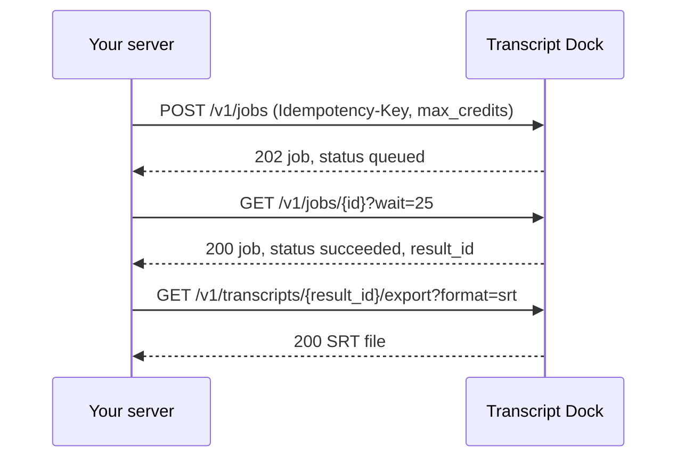

<p align="center">
  <a href="https://www.transcriptdock.com"></a>
</p>

<h1 align="center">Transcript Dock API</h1>

<p align="center">
  <strong>Transcripts from YouTube, TikTok, Instagram and your own media through one API.</strong>
</p>

<p align="center">
  <a href="https://www.transcriptdock.com">Website</a> •
  <a href="https://www.transcriptdock.com/docs/api-reference">API docs</a> •
  <a href="https://www.transcriptdock.com/pricing">Pricing</a> •
  <a href="#quick-start">Quick start</a> •
  <a href="#examples">Examples</a> •
  <a href="./skills/transcriptdock-api/SKILL.md">Agent skill</a>
</p>

<p align="center">
  <a href="https://www.transcriptdock.com/docs/api-reference"></a>
  <a href="https://www.transcriptdock.com/docs/openapi.yaml"></a>
  <a href="https://www.transcriptdock.com/pricing"></a>
  <a href="https://www.transcriptdock.com/docs/platforms"></a>
  <a href="https://www.transcriptdock.com/docs/mcp"></a>
  <a href="https://pypi.org/project/transcriptdock/"></a>
  <a href="./LICENSE"></a>
</p>

---

## Why Transcript Dock

Getting a transcript from a video link sounds simple until you need it from three platforms, with timing, for videos that have no captions. Transcript Dock puts that behind one job API.

- **One API for every source.** YouTube and TikTok links, Instagram Reels, files you upload and direct https media links all return the same transcript object.
- **Captions first, AI when needed.** `captions_only` reads the platform or creator captions for 1 credit. `auto` uses captions when they exist and AI transcription when they do not. `transcribe` always runs AI transcription.
- **Honest timing.** Captions come with per cue timing. AI transcription adds per word timing and confidence. `timing_granularity` tells you which one you got.
- **Spend you control.** `max_credits` caps every AI job. The media is measured first, and a job that would cost more fails with nothing charged.
- **Safe retries.** Every create takes an `Idempotency-Key`. A replay returns the original result at no cost.
- **Free where it should be.** Failed jobs, polling, exports and idempotent replays cost nothing.
- **Find videos too.** List a YouTube search, channel or playlist, or a TikTok profile, then feed the links into a batch.
- **Built for agents.** A hosted MCP server, an agent skill in this repo and an OpenAPI 3.1 spec.

What it does not do: there is no translation, summarization or speaker labelling in v1. Only public media works.

## How it works

Every transcript is a job. Submit a source, wait for the job, then read or export the result as often as you like.



1. **Submit.** `POST /v1/jobs` answers `202` with a queued job. If your workspace already holds a transcript for the same video and options, it answers `200` with a finished job for free.
2. **Wait.** `GET /v1/jobs/{id}?wait=25` holds the request for up to 25 seconds and returns as soon as the job is final. Or register a [webhook](#webhooks) and skip polling.
3. **Read or export.** `GET /v1/transcripts/{result_id}` returns JSON. `GET /v1/transcripts/{result_id}/export?format=txt|json|srt|vtt` returns a file.

### Modes

| Mode | What it does | Cost | Sources |
|---|---|---|---|
| `captions_only` | Reads the creator or platform captions. Never starts AI transcription. Fails with `NO_CAPTIONS` when there are none. | 1 credit per successful transcript | YouTube, TikTok |
| `auto` | Captions when they exist, AI transcription when they do not. | 1 credit with captions, otherwise 2 credits per started minute | YouTube, TikTok, Instagram, uploads, direct links |
| `transcribe` | AI transcription of the audio, with word timing. | 2 credits per started minute, 60 second minimum | YouTube, TikTok, Instagram, uploads, direct links |

`auto` and `transcribe` need a paid plan. The free plan answers them with `402 PLAN_REQUIRED`. Instagram, uploads and direct links have no caption path, so they take `auto` or `transcribe` only. `GET /v1/capabilities` returns this matrix for your key, so a client can show only what will work.

### Sources

| Source | Accepted input | Modes |
|---|---|---|
| YouTube | `youtube.com/watch?v=`, `youtu.be/`, `/shorts/`, `/live/` | `captions_only`, `auto`, `transcribe` |
| TikTok | `tiktok.com/@user/video/`, `vm.tiktok.com/` share links | `captions_only`, `auto`, `transcribe` |
| Instagram (beta) | Public Reels `instagram.com/reel/`, public video posts `instagram.com/p/` | `auto`, `transcribe` |
| Your files | mp3, wav, m4a, ogg, aac, mp4, webm through `POST /v1/uploads` | `auto`, `transcribe` |
| Direct links | Any public https URL that serves an audio or video file | `auto`, `transcribe` |

Limits for every source: 2 hours of media and 250 MB.

## Endpoints

Base URL `https://www.transcriptdock.com`. Authenticate with `Authorization: Bearer td_live_...`.

| Method | Path | What it does | Credits |
|---|---|---|---|
| `POST` | `/v1/jobs` | Transcribe one video, file or link | 1 per caption transcript, 2 per minute of AI transcription |
| `GET` | `/v1/jobs/{id}` | Job status, waits up to 25 s with `?wait=25` | Free |
| `GET` | `/v1/jobs` | Job history, cursor paging | Free |
| `POST` | `/v1/jobs/{id}/cancel` | Cancel before AI transcription starts | Free |
| `POST` | `/v1/jobs/{id}/retry` | New job from a retryable failure | As a new job |
| `POST` | `/v1/batches` | Many jobs in one atomic request | Per item |
| `GET` | `/v1/batches/{id}` | Batch status and child jobs | Free |
| `GET` | `/v1/transcripts/{id}` | Transcript JSON | Free |
| `GET` | `/v1/transcripts/{id}/export` | `txt`, `json`, `srt` or `vtt` file | Free |
| `DELETE` | `/v1/transcripts/{id}` | Delete a transcript | Free |
| `POST` | `/v1/uploads` | Reserve a signed upload URL | Free |
| `POST` | `/v1/uploads/{id}/complete` | Mark an upload ready | Free |
| `POST` | `/v1/video-discoveries` | YouTube search, channel, playlist or TikTok profile listing | 1 per page |
| `GET` | `/v1/video-discoveries/{id}` | Discovery result | Free |
| `POST` | `/v1/language-discoveries` | Caption languages of a YouTube video | 1 |
| `GET` | `/v1/language-discoveries/{id}` | Language list | Free |
| `GET` | `/v1/webhook-endpoints` | List webhook endpoints | Free |
| `GET` | `/v1/usage` | Plan and credit balance | Free |
| `GET` | `/v1/capabilities` | What your key can do (public without a key) | Free |

Full request and response schemas: [API reference](https://www.transcriptdock.com/docs/api-reference) and [OpenAPI 3.1](https://www.transcriptdock.com/docs/openapi.yaml). A compact reference lives in [docs/README.md](./docs/README.md).

## Credit costs

| What | Credits |
|---|---|
| Caption transcript (YouTube, TikTok) | 1 per successful transcript |
| AI transcription (any source) | 2 per started minute, 60 second minimum |
| Video discovery (YouTube search, channel, playlist, TikTok profile) | 1 per page |
| Caption language discovery (YouTube) | 1 |
| Failed job | 0 |
| Polling, transcript reads and exports | 0 |
| Idempotent replay (same key, same body) | 0 |
| Same video and options already transcribed in your workspace | 0 (`billing.kind: "cached"`) |

While a job runs, its maximum cost is held (`billing.credits_reserved`). When it finishes, only the real cost is charged (`billing.credits_charged`) and the rest is released.

### Worked examples

| Job | Credits |
|---|---|
| A YouTube video with captions, `captions_only` | 1 |
| A TikTok video with no captions, `captions_only` | 0 (fails with `NO_CAPTIONS`) |
| A 15 second Instagram Reel, `auto` | 2 (the 60 second minimum) |
| A 90 second TikTok, `transcribe` | 4 (2 started minutes) |
| A 10 minute uploaded podcast clip, `transcribe` | 20 |
| A 2 hour lecture from a direct link, `transcribe` | 240 |
| One page of 20 playlist videos, then a batch of their captions | 1 + 20 = 21 |
| Exporting that lecture as `txt`, `srt` and `vtt` | 0 |

## Plans

One credit balance covers captions, AI transcription and discovery.

| | Free | Starter | Pro | Scale |
|---|---|---|---|---|
| Price | $0, no card | $19 a month or $190 a year | $49 a month or $490 a year | $149 a month or $1,490 a year |
| Credits | 50 every 30 days | 2,000 a month | 6,000 a month | 20,000 a month |
| Extra credits | Not available | $8 per 1,000 | $7 per 1,000 | $6 per 1,000 |
| Sources | YouTube and TikTok captions | YouTube, TikTok, Instagram, uploads, direct links | YouTube, TikTok, Instagram, uploads, direct links | YouTube, TikTok, Instagram, uploads, direct links |
| AI transcription | Not included | 2 credits a minute | 2 credits a minute | 2 credits a minute |
| Batch size | 1 link | 10 links | 25 links | 50 links |
| Submits a minute | 10 | 60 | 120 | 300 |
| Jobs in progress | 10 | 100 | 500 | 2,000 |
| Retention | 7 days | 30 days | 90 days | 90 days |

Yearly billing gives 2 months free. Yearly plans still get their credits every month, and unused monthly credits do not roll over. Purchased credits never expire. Reads (job polling, transcripts, exports) have a separate limit of 120 a minute on every plan. Prices and limits can change: [transcriptdock.com/pricing](https://www.transcriptdock.com/pricing) is the source of truth.

## Quick start

1. [Create a free account](https://www.transcriptdock.com/signup). No card needed.
2. Create an API key on the API keys page of the [dashboard](https://www.transcriptdock.com/dashboard). It is shown once and starts with `td_live_`.
3. Keep it on your server, in an environment variable:

```bash
export TRANSCRIPTDOCK_API_KEY="td_live_..."
```

Never call the API from a browser: anyone could read your key.

### cURL

```bash
# 1. Submit. Captions only, so this costs at most 1 credit.
curl -sS -X POST https://www.transcriptdock.com/v1/jobs \
  -H "Authorization: Bearer $TRANSCRIPTDOCK_API_KEY" \
  -H "Idempotency-Key: $(uuidgen)" \
  -H "Content-Type: application/json" \
  -d '{"source":{"url":"https://www.youtube.com/watch?v=dQw4w9WgXcQ"},"mode":"captions_only","max_credits":1}'

# 2. Wait. Returns as soon as the job is final, up to 25 seconds per call.
curl -sS "https://www.transcriptdock.com/v1/jobs/JOB_ID?wait=25" \
  -H "Authorization: Bearer $TRANSCRIPTDOCK_API_KEY"

# 3. Export the transcript. Free, as often as you like.
curl -sS "https://www.transcriptdock.com/v1/transcripts/RESULT_ID/export?format=srt" \
  -H "Authorization: Bearer $TRANSCRIPTDOCK_API_KEY"
```

No `uuidgen`? Any unique string of 8 to 128 printable characters works as the key. [`examples/curl/examples.sh`](./examples/curl/examples.sh) has a fallback.

### JavaScript (Node 18+, no dependencies)

```js
import { randomUUID } from "node:crypto";

const API = "https://www.transcriptdock.com";
const headers = { Authorization: `Bearer ${process.env.TRANSCRIPTDOCK_API_KEY}` };

async function call(method, path, body, idempotencyKey) {
  const res = await fetch(API + path, {
    method,
    redirect: "error",
    headers: {
      ...headers,
      ...(body && { "Content-Type": "application/json" }),
      ...(idempotencyKey && { "Idempotency-Key": idempotencyKey }),
    },
    body: body && JSON.stringify(body),
  });
  if (!res.ok) throw new Error(`${res.status} ${await res.text()}`);
  return path.includes("/export") ? res.text() : res.json();
}

// Save this key with your record. Resend the same body with it if a response is lost.
let job = await call("POST", "/v1/jobs", {
  source: { url: "https://www.youtube.com/watch?v=dQw4w9WgXcQ" },
  mode: "captions_only",
  max_credits: 1,
}, randomUUID());

while (!["succeeded", "failed", "cancelled"].includes(job.status)) {
  job = await call("GET", `/v1/jobs/${job.id}?wait=25`);
}

if (job.status === "succeeded") {
  console.log(await call("GET", `/v1/transcripts/${job.result_id}/export?format=srt`));
} else {
  console.error(job.status, job.error);
}
```

### Python (`pip install transcriptdock`)

```python
import os
from uuid import uuid4
from transcriptdock import TranscriptDock, JobTimeoutError

client = TranscriptDock(os.environ["TRANSCRIPTDOCK_API_KEY"])
print(client.capabilities())

# Generate once per intended operation. Save this key and the returned job ID.
# Reuse the same key and exact body if a submission's response is lost.
submission_key = str(uuid4())
job = client.create_job(
    {"source": {"url": "https://www.youtube.com/watch?v=dQw4w9WgXcQ"},
     "mode": "captions_only", "max_credits": 1},
    idempotency_key=submission_key,
)
try:
    job = client.wait_for_job(job["id"], timeout=120)
except JobTimeoutError as error:
    print("Still running", error.job)
else:
    if job["status"] == "succeeded":
        transcript = client.get_transcript(job["result_id"])
        print(transcript)
        print(client.export_transcript(job["result_id"], "srt"))
    else:
        print(job["status"], job.get("error"))
```

## What you get back

Example data. A finished job:

```json
{
  "id": "11111111-1111-4111-8111-111111111111",
  "status": "succeeded",
  "stage": null,
  "result_id": "22222222-2222-4222-8222-222222222222",
  "error": null,
  "billing": { "credits_reserved": 0, "credits_charged": 1, "kind": "captions" },
  "source": {
    "platform": "youtube",
    "media_id": "aBcDeFgHiJk",
    "canonical_url": "https://www.youtube.com/watch?v=aBcDeFgHiJk",
    "title": "Example video",
    "upload_id": null
  },
  "options": { "mode": "captions_only", "language": null, "caption_preference": "prefer_creator" },
  "created_at": "2026-11-18T10:00:00.000Z"
}
```

And its transcript from `GET /v1/transcripts/{result_id}`:

```json
{
  "id": "22222222-2222-4222-8222-222222222222",
  "source": {
    "platform": "youtube",
    "media_id": "aBcDeFgHiJk",
    "canonical_url": "https://www.youtube.com/watch?v=aBcDeFgHiJk",
    "title": "Example video"
  },
  "source_origin": "creator_captions",
  "language": "en",
  "text": "Welcome back to the workshop. Today we sand the table top.",
  "segments": [
    { "start": 0.0, "end": 2.6, "text": "Welcome back to the workshop." },
    { "start": 2.6, "end": 5.1, "text": "Today we sand the table top." }
  ],
  "words": null,
  "timing_granularity": "segment",
  "duration_seconds": 312.0,
  "recognition": null,
  "extraction_version": "worker-0.1.0",
  "created_at": "2026-11-18T10:00:14.000Z"
}
```

- `start` and `end` are **seconds**.
- `source_origin` is `creator_captions`, `platform_captions` (for example YouTube automatic captions) or `speech_recognition` (AI transcription).
- `words` is filled only by AI transcription: `{ start, end, text, confidence }` per word, with `timing_granularity: "word"`.
- `recognition` is set only for AI transcription, with the `profile`, the `model` and a `quality_status` for the detected language.
- A job status moves `queued`, `processing`, `awaiting_provider` (during AI transcription), then one of `succeeded`, `failed` or `cancelled`.

## Webhooks

Polling with `?wait=25` is fine for scripts. For pipelines, register a webhook and let Transcript Dock call you.

1. Register an `https` URL on the Webhooks page of the [dashboard](https://www.transcriptdock.com/dashboard). Registering and disabling endpoints needs a signed in session. An API key can list endpoints but gets `403 FORBIDDEN` when it tries to create one. The signing secret is shown once: store it like a password.
2. Pass the endpoint id as `webhook_endpoint_id` when you create a job or a batch.
3. Transcript Dock sends `job.succeeded`, `job.failed` or `batch.completed` when the work is final.

```json
{
  "event_id": "44444444-4444-4444-8444-444444444444",
  "type": "job.succeeded",
  "created_at": "2026-11-18T10:00:14.000Z",
  "job_id": "11111111-1111-4111-8111-111111111111",
  "batch_id": null,
  "result_id": "22222222-2222-4222-8222-222222222222",
  "metadata": { "order": "8812" },
  "error": null
}
```

The event does not carry the transcript text. Fetch or export `result_id` when you receive it.

**Verify every delivery.** Each request has three headers: `X-TranscriptDock-Event-Id`, `X-TranscriptDock-Timestamp` and `X-TranscriptDock-Signature`. The signature is a hex HMAC SHA256 of `{event_id}.{timestamp}.{raw_body}` keyed with your endpoint secret.

- Compute it over the raw request body, before any JSON parsing.
- Compare in constant time.
- Reject timestamps more than five minutes away from your clock.
- Answer with any 2xx within a few seconds, and do the slow work afterwards. Redirects are not followed.
- Failed deliveries are retried with backoff, and an event can arrive more than once. Deduplicate on `event_id`.

```js
import { createHmac, timingSafeEqual } from "node:crypto";

export function verifyTranscriptDock(eventId, timestamp, rawBody, signature, secret) {
  if (Math.abs(Date.now() / 1000 - Number(timestamp)) > 300) return false;
  const expected = createHmac("sha256", secret)
    .update(`${eventId}.${timestamp}.`)
    .update(rawBody) // the exact bytes you received
    .digest("hex");
  return expected.length === String(signature).length &&
    timingSafeEqual(Buffer.from(expected), Buffer.from(String(signature)));
}
```

The full contract, including retries and payload fields, is in the [webhook docs](https://www.transcriptdock.com/docs/api-reference#webhooks).

## Errors

Every error has the same envelope. Quote `request_id` (also sent as the `X-Request-Id` header) when you contact support.

```json
{
  "error": {
    "code": "INSUFFICIENT_BALANCE",
    "message": "Not enough credits. Buy credits or upgrade your plan to continue.",
    "retryable": false,
    "details": { "detail": "This job needs more credits than you have left." },
    "doc_url": "https://www.transcriptdock.com/docs/api-reference#error-codes"
  },
  "request_id": "66666666-6666-4666-8666-666666666666"
}
```

A job that fails after it was accepted still returns HTTP 200 on `GET /v1/jobs/{id}`, with `status: "failed"` and the same error object in `error`. Failed jobs cost nothing.

| Code | HTTP | Retry | What to do |
|---|---|---|---|
| `INVALID_REQUEST` | 422 | No | A field is missing or malformed. `details.detail` names it. |
| `INVALID_URL` / `UNSUPPORTED_SOURCE` | 422 | No | Send a supported https link. |
| `CAPABILITY_UNAVAILABLE` | 422 | No | That mode is not available for this source. Check `GET /v1/capabilities`. |
| `UNAUTHENTICATED` | 401 | No | Missing or invalid API key. |
| `FORBIDDEN` | 403 | No | The key lacks the scope for this endpoint. |
| `INSUFFICIENT_BALANCE` | 402 | No | Buy credits or upgrade. |
| `PLAN_REQUIRED` | 402 | No | AI transcription, Instagram, uploads and larger batches need a paid plan. |
| `BUDGET_EXCEEDED` | 402 | No | The measured cost is above `max_credits`. Nothing was charged. Raise the cap or skip the media. |
| `IDEMPOTENCY_CONFLICT` | 409 | No | The key was used with a different body. Use a new key. |
| `JOB_NOT_RETRYABLE` | 409 | No | The failure was final. Fix the input and submit a new job. |
| `RATE_LIMITED` | 429 | Yes | Wait `Retry-After` seconds, then resend with the same idempotency key. |
| `NO_CAPTIONS` | 422 | No | The video has no captions and the mode was `captions_only`. Use `auto` or `transcribe`. |
| `LANGUAGE_UNAVAILABLE` | 422 | No | None of `caption_languages` exists on the video. Drop the list to take the default track. |
| `SOURCE_NOT_FOUND` / `SOURCE_PRIVATE` / `SOURCE_AUTH_REQUIRED` / `SOURCE_REGION_RESTRICTED` | 422 | No | Only public, reachable media works. |
| `DURATION_LIMIT_EXCEEDED` / `FILE_TOO_LARGE` | 413 | No | Media over 2 hours or 250 MB. |
| `TIMESTAMPS_UNAVAILABLE` | 422 | No | No timing for SRT or VTT. Export `txt` or `json`. |
| `SOURCE_RATE_LIMITED` / `SOURCE_BLOCKED` / `SOURCE_TIMEOUT` | 503 | Yes | The platform is throttling. The job retries automatically. |
| `INTERNAL_ERROR` | 500 | Yes | Retry with the same idempotency key. Report the request id if it persists. |

The [full error list](https://www.transcriptdock.com/docs/api-reference#error-codes) has every code.

## Idempotency and spend caps

Two habits make the API safe to call from scripts, queues and agents.

**Send an `Idempotency-Key` on every create.** It is required on `POST /v1/jobs`, `/v1/batches`, `/v1/video-discoveries`, `/v1/language-discoveries` and `/v1/jobs/{id}/retry`. Use 8 to 128 printable ASCII characters.

- Same key and same body: you get the original object back. Nothing is created or charged twice.
- Same key and a different body: `409 IDEMPOTENCY_CONFLICT`.
- Generate the key once per intended operation and save it with your record. If a response is lost, resend the same body with the same key. Never resubmit blindly with a fresh key.
- A good key is your own id for the thing you are transcribing, for example `yt-dQw4w9WgXcQ-captions`.
- A retry (`POST /v1/jobs/{id}/retry`) needs a new key, because it is a new job.

**Set `max_credits` on AI transcription.** The media is measured first. If the cost would be above your cap, the job fails with `BUDGET_EXCEEDED` and nothing is charged. Without a cap the default covers the 2 hour maximum (240 credits).

| Longest media you accept | `max_credits` |
|---|---|
| 1 minute | 2 |
| 5 minutes | 10 |
| 10 minutes | 20 |
| 30 minutes | 60 |
| 2 hours | 240 |

`max_credits` is ignored for `captions_only`, which always costs 1 credit. The examples in this repo still send it, so a later switch to `auto` keeps a cap.

## Examples

Every example reads `TRANSCRIPTDOCK_API_KEY`, sends an idempotency key and caps `max_credits`. Running them spends real credits, so read the comment at the top of each file first.

| Example | What it shows |
|---|---|
| [curl/examples.sh](./examples/curl/examples.sh) | Every core call as a cURL subcommand: capabilities, usage, captions, auto, wait, export, batch, upload, retry |
| [javascript/quickstart.mjs](./examples/javascript/quickstart.mjs) | Submit a link, wait with long polling, export SRT |
| [javascript/batch.mjs](./examples/javascript/batch.mjs) | A YouTube and TikTok batch, then each transcript as text |
| [javascript/upload.mjs](./examples/javascript/upload.mjs) | Upload a local file and transcribe it with a spend cap |
| [javascript/webhook-receiver.mjs](./examples/javascript/webhook-receiver.mjs) | A webhook receiver that verifies signatures and deduplicates events |
| [python/quickstart.py](./examples/python/quickstart.py) | The same flow with the `transcriptdock` package |
| [python/batch.py](./examples/python/batch.py) | A batch with per item results |
| [python/upload.py](./examples/python/upload.py) | Upload a local file, then AI transcription with `max_credits` |

```bash
node examples/javascript/quickstart.mjs "https://www.youtube.com/watch?v=dQw4w9WgXcQ"
python examples/python/quickstart.py "https://www.tiktok.com/@tiktok/video/7680721699171601694"
bash examples/curl/examples.sh help
```

## SDKs

Plain HTTP works everywhere, and every example in this repo uses either `fetch` or the Python SDK. Typed clients:

| Language | Package | Status |
|---|---|---|
| Python | [`transcriptdock`](https://pypi.org/project/transcriptdock/) on PyPI ([source](https://github.com/TranscriptDock/transcriptdock-python)) | Published |
| Go | [`github.com/TranscriptDock/transcriptdock-go`](https://github.com/TranscriptDock/transcriptdock-go) | Published |
| Ruby | `transcriptdock` gem ([source](https://github.com/TranscriptDock/transcriptdock-ruby)) | Published |
| PHP | `transcriptdock/transcriptdock` on Packagist ([source](https://github.com/TranscriptDock/transcriptdock-php)) | Published |
| .NET | `TranscriptDock` on NuGet ([source](https://github.com/TranscriptDock/transcriptdock-dotnet)) | Published |
| JavaScript and TypeScript | [`transcriptdock`](https://www.npmjs.com/package/transcriptdock) on npm ([source](https://github.com/TranscriptDock/transcriptdock-js)) | Published |
| Dart and Flutter | [`transcriptdock`](https://pub.dev/packages/transcriptdock) on pub.dev ([source](https://github.com/TranscriptDock/transcriptdock-dart)) | Published |
| Java | `com.transcriptdock:transcriptdock` ([source](https://github.com/TranscriptDock/transcriptdock-java)) | Coming soon |
| Rust | `transcriptdock` on crates.io ([source](https://github.com/TranscriptDock/transcriptdock-rust)) | Coming soon |
| Swift | Swift Package Manager, `from: "0.1.0"` ([source](https://github.com/TranscriptDock/transcriptdock-swift)) | Published |

Generating your own client? Start from the [OpenAPI 3.1 spec](https://www.transcriptdock.com/docs/openapi.yaml) ([repo](https://github.com/TranscriptDock/transcriptdock-openapi)). No code at all: the [n8n node](https://github.com/TranscriptDock/n8n-nodes-transcriptdock) (`n8n-nodes-transcriptdock`) and the [Apify Actor](https://github.com/TranscriptDock/transcriptdock-apify).

## MCP and AI agents

### Hosted MCP server

Transcript Dock runs a hosted MCP server at `https://www.transcriptdock.com/mcp` (Streamable HTTP). It signs you in with OAuth, or accepts an API key as a bearer header. Use the `www` URL exactly: the apex domain redirects, and clients drop the `Authorization` header on a cross origin redirect.

```bash
claude mcp add --transport http transcriptdock https://www.transcriptdock.com/mcp
```

Then run `/mcp` in Claude Code and choose Authenticate. In the Claude apps, add `https://www.transcriptdock.com/mcp` as a custom connector. Cursor, Windsurf and other clients are covered in the [MCP docs](https://www.transcriptdock.com/docs/mcp). A local stdio server is on npm as `@transcriptdock/mcp` ([source](https://github.com/TranscriptDock/transcriptdock-mcp)).

The MCP tools include `get_video_transcript` (submit, wait and return text in one call), `transcribe`, `get_job`, `get_transcript`, `wait_for_job`, `search_youtube`, `list_channel_videos`, `list_playlist_videos` and `list_tiktok_user_videos`.

### Agent skill in this repo

[`skills/transcriptdock-api/SKILL.md`](./skills/transcriptdock-api/SKILL.md) teaches an agent to use the HTTP API safely: check capabilities, submit with an idempotency key and a `max_credits` cap, wait, export, ask before paid AI transcription, and never invent timestamps.

```bash
# Claude Code: install for every project
mkdir -p ~/.claude/skills
cp -r skills/transcriptdock-api ~/.claude/skills/

# or for one project
mkdir -p .claude/skills
cp -r skills/transcriptdock-api .claude/skills/
```

The skill reads your key from `TRANSCRIPTDOCK_API_KEY`. Never paste a key into a chat.

## FAQ

<details>
<summary><strong>Do failed jobs cost anything?</strong></summary>

No. A failed job releases its hold in full. You pay only for transcripts that succeed, and exports and polling are always free.
</details>

<details>
<summary><strong>What happens when a video has no captions?</strong></summary>

With `captions_only` the job fails with `NO_CAPTIONS` and costs nothing. With `auto` it falls back to AI transcription at 2 credits per started minute, capped by `max_credits`. AI transcription needs a paid plan.
</details>

<details>
<summary><strong>Can I call the API from a browser or a mobile app?</strong></summary>

Not directly. Your key would be visible to anyone. Call the API from your server and keep the key in an environment variable.
</details>

<details>
<summary><strong>Does it translate transcripts?</strong></summary>

No. `caption_languages` picks among the caption tracks a video already has, and `language` is a hint for AI transcription about the spoken language. There is no translation in v1.
</details>

<details>
<summary><strong>Which videos work?</strong></summary>

Public videos only. Private, members only and age gated videos fail with a `SOURCE_*` error code. Media can be up to 2 hours and 250 MB.
</details>

<details>
<summary><strong>How long are transcripts kept?</strong></summary>

7 days on the free plan, 30 days on Starter and 90 days on Pro and Scale. `DELETE /v1/transcripts/{id}` removes one earlier. Export what you need to keep.
</details>

<details>
<summary><strong>Are timestamps in seconds or milliseconds?</strong></summary>

Seconds, as numbers, on both `segments` and `words`. Caption timing is per cue. Word timing comes only from AI transcription.
</details>

<details>
<summary><strong>Is there a free plan?</strong></summary>

Yes: 50 caption credits every 30 days with no card, for YouTube and TikTok captions. AI transcription, Instagram, uploads and batches larger than one link need a paid plan.
</details>

## Platform repos

| Repo | Focus |
|---|---|
| [youtube-transcript-api](https://github.com/TranscriptDock/youtube-transcript-api) | YouTube captions, automatic captions, AI transcription, search, channel and playlist discovery, caption languages |
| [tiktok-transcript-api](https://github.com/TranscriptDock/tiktok-transcript-api) | TikTok captions, AI fallback, profile video discovery, batches |
| [instagram-transcript-api](https://github.com/TranscriptDock/instagram-transcript-api) | AI transcription for public Instagram Reels and video posts |

## Chrome extension

Want transcripts without writing code? The [Transcript Dock extension for Chrome](https://chromewebstore.google.com/detail/bepajpcnjahahnkjkfeojmpbddakoodg) shows transcripts beside YouTube, TikTok and Instagram videos. More at [transcriptdock.com/extension](https://www.transcriptdock.com/extension).

---

## Issues and feedback

This repo holds examples, docs and an agent skill for the hosted Transcript Dock API.

- Found a bug in an example, or the API behaving differently from the docs? [Open an issue](../../issues/new/choose) and include the `X-Request-Id`.
- Have an idea for a feature or a new example? Open a feature request.
- Security issue? Email [transcriptdock@volods.com](mailto:transcriptdock@volods.com) instead of opening an issue.

See [CONTRIBUTING.md](./CONTRIBUTING.md) before sending a pull request.

## Links

- Website: [transcriptdock.com](https://www.transcriptdock.com)
- Docs: [quickstart](https://www.transcriptdock.com/docs/quickstart), [API reference](https://www.transcriptdock.com/docs/api-reference), [sources](https://www.transcriptdock.com/docs/platforms)
- OpenAPI spec: [openapi.yaml](https://www.transcriptdock.com/docs/openapi.yaml)
- Pricing: [transcriptdock.com/pricing](https://www.transcriptdock.com/pricing)
- Changelog: [docs/changelog](https://www.transcriptdock.com/docs/changelog)
- Contact: [transcriptdock@volods.com](mailto:transcriptdock@volods.com)

## License

The examples, docs and skill in this repository are released under the [MIT License](./LICENSE).

The Transcript Dock API is a hosted service covered by its [Terms of Service](https://www.transcriptdock.com/docs/terms).
